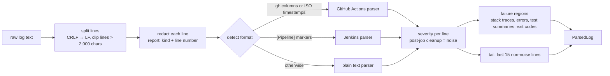

# 04 – Log parsing and redaction

**Status: implemented in Phase 2.** Source: `app/redaction/__init__.py`,
`app/ingestion/` (`formats.py`, `regions.py`, `__init__.py`),
`app/schemas/logs.py`, `app/api/parse.py`. Endpoint: `POST /v1/parse`.

## What it is, in plain language

A CI log is thousands of lines, and most of them are setup noise. Parsing
turns it into **evidence**: the lines that show what failed, each with its
original line number, so a diagnosis can say "line 342 shows 1 failed test"
and a reviewer can check it. **Redaction** removes secrets (tokens,
passwords, keys) first, so they never reach storage, a model prompt or an API
response.

## Why it is built this way

- **Redact first, then parse.** Every later stage only ever sees redacted
  text. The alternative (redact just before the model call) leaves secrets in
  every intermediate structure and log line.
- **Never change the number of lines.** Each secret is replaced in place with
  `[REDACTED:<kind>]`; a private-key block becomes one marker per line. Line
  numbers therefore stay valid as evidence references.
- **Rules, not a model.** Parsing is deterministic and testable and needs no
  LLM, so it works when the model is down (the "deterministic mode" the brief
  asks for).
- **Alternatives considered:** dedicated scanners such as `detect-secrets` or
  `gitleaks` have more rules, but add a dependency and are built for scanning
  repositories, not streaming log lines with stable line numbers. They are a
  reasonable later upgrade.

## Diagram



## Step by step

1. **Split.** Normalise line endings and clip any line longer than 2,000
   characters (minified bundles), flagging `long_lines_truncated`.
2. **Redact** (`redact_lines`). Known token formats (GitHub, AWS access key
   ID, Slack, OpenAI, Google, npm, JWT), `Bearer` tokens, credentials inside
   URLs, private-key blocks, and `NAME=value` / `NAME: value` assignments
   where the name ends in password, secret, token, api_key and similar.
3. **Detect the format.** At least half the non-empty sample lines look like
   GitHub Actions (tab columns or an ISO timestamp prefix) → `github_actions`.
   Any `[Pipeline]`, `Started by …` or `Finished: FAILURE` → `jenkins`.
   Otherwise `text`. Callers can force a format.
4. **Parse lines** into number, job, step (the Jenkins stage), timestamp,
   GitHub workflow command (`##[error]`, `##[warning]`, …) and clean text.
5. **Classify severity** with general markers: `ERROR`, `FAILED`, exception
   names, `npm ERR!`, failure counts ("3 failed"), ❌/✗, exit codes ≠ 0.
6. **Mark noise.** Everything after `Post job cleanup.` until the next job.
7. **Extract regions.** Python tracebacks run to the exception line; error
   lines get ±3 lines of context (clipped so they never reach into noise);
   test summaries and exit codes become their own regions. Overlapping
   regions of the same kind merge; at most the last 20 are kept.
8. **Tail.** The last 15 non-noise lines: the exact window that won the v0.2
   retrieval experiment, kept so that experiment stays reproducible.

## Code example (matches the implementation)

```python
from app.ingestion import parse_log

log = "Run tests\nexport API_KEY=abcd1234efgh\nFAILED tests/test_x.py::test_y\nexit code 1"
parsed = parse_log(log)
parsed.redaction.by_kind      # {'assigned_secret': 1}
parsed.redaction.lines        # [2]
[r.kind for r in parsed.regions]   # ['error', 'exit_code']
parsed.tail[1].text           # 'export API_KEY=[REDACTED:assigned_secret]'
```

## Measured on the real dataset

- All 123 real GitHub Actions logs parse without errors; a regression test
  checks every region's line numbers against the original log.
- Logs with no error evidence beyond an exit code: 6 of 51 dev logs after
  calibrating the markers on the dev logs only (14 before). On the 72
  held-out logs: 18, including gate and "cause not in log" cases.
- Redaction on the 123 public logs: 7 false positives found at first
  (GitHub's partial `ghs_****` mask, `passwd` prompts, a URL query in a PR
  description), all fixed with regression tests. Now 0 hits, which is
  expected: GitHub already masks configured secrets as `***`.

## Complexity and limits

- O(n) in the number of lines; about 45 ms per real log (123 logs in 5.6 s
  including file reads).
- **Pattern-based redaction misses secrets with no recognisable shape** (a
  random password printed on its own). There is deliberately no "long random
  string" rule: it would wipe commit SHAs, digests and IDs. Treat redaction
  as risk reduction, not a guarantee.
- `NAME: value` with an all-letters value is not redacted (to avoid prose
  like "New password: Retype"), so an all-letters password in YAML form would
  be missed.

## Failure modes and security

| Risk | Control |
|---|---|
| Secret reaches the model | Redaction runs before `/v1/diagnose` builds the prompt (test: `test_secrets_are_redacted_before_the_model_call`) |
| Secret echoed by the API | `/v1/parse` returns only redacted text (test checks the raw response body) |
| Secret value in the report | The report stores kind and line number only |
| Huge input | `MAX_LOG_CHARS` (413) and per-line clipping |
| Fake secrets in the repo | Tests build token-shaped strings at runtime; fixtures contain none |

## Interview questions

1. **Why redact before parsing rather than before the model call?** So no
   component, log line or stored record ever holds the secret. It is the
   difference between one control point and many.
2. **How do you keep evidence references valid after redaction?** Replace in
   place and never add or remove lines, so line N before is line N after.
3. **Why not redact long random-looking strings?** Commit SHAs, digests and
   UUIDs look random too. The false-positive cost (destroying evidence) was
   judged higher, and the limitation is documented.
4. **How did you test redaction without committing secrets?** Token-shaped
   strings are assembled at runtime in the tests; the real public logs were
   used to find and fix false positives.
5. **Why keep a 15-line tail when you have regions?** It is the measured v0.2
   baseline; keeping it makes later retrieval changes comparable with it.

## Hands-on exercise

```bash
curl -X POST http://localhost:8000/v1/parse -H "Content-Type: application/json" \
  -d "{\"log_text\": \"DB_PASSWORD=s3cret99\nTraceback (most recent call last):\n  File \\\"x.py\\\", line 1\nValueError: bad\"}"
```

**Expected result:** `redaction.by_kind == {"assigned_secret": 1}` on line 1,
and one `stack_trace` region from line 2 to line 4 anchored on
`ValueError: bad`.
