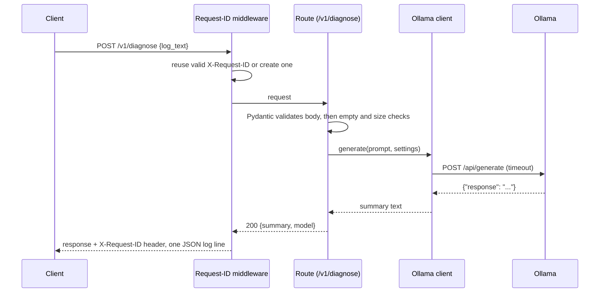

# 10 – API, FastAPI and Pydantic

**Status: implemented in Phase 1.** Source: `app/main.py`, `app/api/`,
`app/schemas/`, `app/errors.py`, `app/config.py`,
`app/observability/requests.py`, `app/diagnosis/ollama.py`.

## What it is, in plain language

The API is the front door of PipelineMedic X. Clients send it a CI log over
HTTP and get JSON back. **FastAPI** is the web framework: it maps URLs to
Python functions. **Pydantic** checks that data has the right shape: if a
request is missing a field or has the wrong type, Pydantic rejects it before
any of our code runs.

## Why this project uses it

- **Typed contracts.** Request and response models (`DiagnoseRequest`,
  `DiagnoseResponse`) are Python classes. FastAPI turns them into an OpenAPI
  schema and interactive docs at `/docs`, so the documentation cannot drift
  from the code.
- **Validation at the edge.** Bad input is rejected with a clear error instead
  of failing deep inside the model call.
- **Alternatives considered.** Flask is simpler but has no built-in
  validation or schema generation. Django is far more than a JSON API needs.
  The v0.1 prototype already used FastAPI, so the brief's "extend, don't
  replace" rule also pointed here.

## Diagram



## Step by step

1. **Middleware** (`app/observability/requests.py`) reads `X-Request-ID`. If
   it is a safe string (letters, digits, `.`, `_`, `-`, at most 64
   characters) it is reused, otherwise a random ID is generated. The ID goes
   on the response header and on one JSON log line per request. Request
   bodies are never logged, because CI logs can contain secrets.
2. **Validation.** Pydantic requires `log_text` to be a non-empty string. The
   route also rejects whitespace-only logs (422) and logs longer than
   `MAX_LOG_CHARS` (413), before the model is ever called.
3. **Model call** (`app/diagnosis/ollama.py`). One HTTP call with a timeout.
   Each way it can fail becomes a typed error: unreachable → 503, timeout →
   504, wrong status code or missing text → 502.
4. **Errors** (`app/errors.py`). Every error, including unexpected ones,
   becomes the same JSON shape:
   `{"error": {"code", "message", "request_id"}}`. Unexpected errors return
   a generic message; the stack trace goes to the server log only.

## Configuration

`app/config.py` defines a Pydantic `Settings` model. Each field maps to an
upper-case environment variable (`ollama_timeout_s` ↔ `OLLAMA_TIMEOUT_S`),
with `.env` as a fallback. Every field has a safe default, so nothing needs
configuring to run locally. Invalid values stop the app at startup with a
message naming the variable, for example
`Invalid configuration: OLLAMA_TIMEOUT_S: Input should be greater than 0`.
The Neo4j password is a `SecretStr`, so it never appears in `repr()` or
logs.

## Code example (matches the implementation)

```python
from fastapi.testclient import TestClient
from app.main import app

client = TestClient(app)
resp = client.post("/v1/diagnose", json={"log_text": "   "},
                   headers={"X-Request-ID": "demo-1"})
assert resp.status_code == 422
assert resp.json() == {"error": {
    "code": "validation_error",
    "message": "log_text must contain non-whitespace characters.",
    "request_id": "demo-1"}}
```

## Limits and complexity

- Each request is handled in time proportional to the log length (the
  checks are O(n)), plus the model call, which dominates: about 16 seconds
  for a short log with llama3.2 on a laptop CPU.
- Request handlers are synchronous; FastAPI runs them in a thread pool, so a
  slow model call does not block other requests until the pool is used up.

## Failure modes, security and trade-offs

| Situation | What happens |
|---|---|
| Ollama not running | 503 `provider_unavailable`; `/health/ready` reports `degraded` |
| Ollama too slow | 504 `provider_timeout` after `OLLAMA_TIMEOUT_S` |
| Ollama returns garbage | 502 `provider_bad_response`; nothing invented |
| Huge log | 413 before any model call |
| Bug in our code | 500 `internal_error`, no stack trace sent to the client |

- **Still missing (planned):** secrets in logs are not yet redacted before
  the model call (Phase 2); the summary is not checked against the log, so
  the model can paraphrase or embellish (Phase 4).
- **Legacy endpoint.** `POST /diagnose` takes the log as a query parameter,
  which puts it in URLs and server logs. It is kept, marked deprecated, for
  compatibility.

## Interview questions

1. **Why separate `/health` and `/health/ready`?** Liveness answers "is the
   process up" and must be cheap and never fail because of a dependency.
   Readiness answers "can it do useful work now", so it calls Ollama. An
   orchestrator restarts on failed liveness but only stops routing traffic on
   failed readiness.
2. **Why one error shape?** Clients can handle errors generically by `code`
   without parsing messages, and the `request_id` links a user report to the
   exact server log line.
3. **Why not log request bodies?** CI logs routinely contain tokens and
   passwords. Logging them would copy secrets into another system.
4. **What does Pydantic validation not catch?** Business rules, such as
   whitespace-only logs or size limits that depend on configuration. Those
   are explicit checks in the route.
5. **How do the tests avoid a real model?** `fake_ollama` replaces
   `requests.post` inside the client module and records every call, so tests
   can return any response or raise any network error deterministically.

## Hands-on exercise

Start the API with Ollama stopped and call readiness:

```bash
uvicorn app.main:app
curl http://localhost:8000/health/ready
```

**Expected result:** HTTP 200 with `"status": "degraded"` and
`"ollama": {"status": "unavailable", "detail": "ConnectionError"}`. Then
`POST /v1/diagnose` returns 503 with code `provider_unavailable`.
